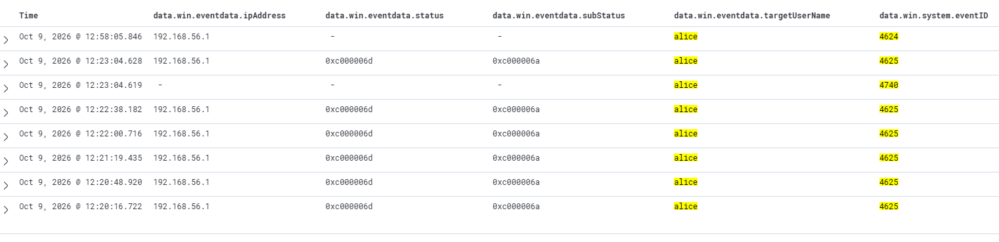
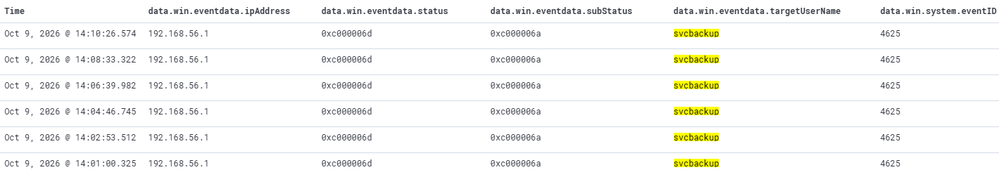

# Investigation: Windows authentication events

Учебное исследование неуспешных и успешных входов Windows в Wazuh. Цель — связать события по учётной записи, источнику и времени, проверить признаки блокировки и определить, какие дополнительные данные нужны для установления причины отказов.

## Краткий результат

| Сценарий | Подтверждено по выписке событий | Граница вывода |
|---|---|---|
| `bob`: ошибка пароля и последующий вход | 4625 → 4624 с интервалом 28,7 секунды; совпадают учётная запись, источник и компьютер назначения | В реальном инциденте такая последовательность сама по себе не устанавливает намерения пользователя |
| `alice`: серия отказов и блокировка | Шесть событий 4625 за 2 минуты 47,9 секунды, событие 4740 и более позднее событие 4624 | Причина серии и точная длительность блокировки по этой выписке не установлены |
| `svcbackup`: регулярные отказы | Шесть событий 4625; интервалы между ними — около 113 секунд | Автоматизация известна из условий лаборатории. Использование сохранённого устаревшего пароля не проверялось |

## Контекст

Источник тестовых подключений — хост Windows 11 с адресом `192.168.56.1`. Компьютер назначения — Windows 11 `DESKTOP-KN3U7PI`, адрес `192.168.56.102`. Подключения выполнялись к ресурсу `SOC-Lab` по SMB. События просматривались в Wazuh, установленном на Ubuntu Server.

Все сценарии создавались намеренно в собственной лаборатории. Объяснения для реального инцидента ниже рассматриваются как гипотезы.

## Метод анализа

1. Выбрать день эксперимента и найти события нужной учётной записи.
2. Сопоставить `targetUserName`, `computer` и `ipAddress`.
3. Проверить тип входа `logonType` и коды отказа `status` / `subStatus`.
4. Расположить события по времени, подсчитать зафиксированные отказы и интервалы.
5. Отделить наблюдения от гипотез и определить следующие проверки.

### Значение событий и кодов

| Поле или событие | Интерпретация |
|---|---|
| 4624 | Успешный вход |
| 4625 | Неуспешная попытка входа |
| 4740 | Блокировка учётной записи |
| `logonType: 3` | Сетевой вход |
| `status: 0xc000006d` | Ошибка входа, связанная с именем пользователя или данными аутентификации |
| `subStatus: 0xc000006a` | Неверный пароль; уточняет причину отказа |

## Сценарий 1 — ошибка пароля для bob, затем успешный вход

**Учебное действие:** подключение под `bob` с неверным паролем, затем с верным паролем.

**Задача анализа:** проверить, относятся ли отказ и успешный вход к одной учётной записи, источнику и компьютеру назначения.

### Поиск в Wazuh

Выбрать временной диапазон **8 октября 2026 года**, включающий события ниже.

```text
data.win.system.computer: "DESKTOP-KN3U7PI"
AND data.win.eventdata.targetUserName: "bob"
AND (data.win.system.eventID: "4625" OR data.win.system.eventID: "4624")
```

### Последовательность событий

Дата: **8 октября 2026 года**.

| Время | Событие | Наблюдение |
|---|---|---|
| 21:29:20.254 | 4625 | Отказ; `status: 0xc000006d`, `subStatus: 0xc000006a` |
| 21:29:48.920 | 4624 | Успешный вход |

Для обоих событий в рабочем журнале зафиксированы:

- Учётная запись: `bob`.
- Компьютер назначения: `DESKTOP-KN3U7PI`.
- Адрес источника: `192.168.56.1`.
- Тип входа: `3`.

**Интервал между событиями:** 28,7 секунды.

### Интерпретация и следующие проверки

В лаборатории последовательность соответствует намеренно введённому неверному паролю и последующему правильному паролю.

При реальном расследовании события подтверждали бы отказ и успешный вход с совпадающими ключевыми полями. Они не доказывали бы, что оба действия совершил один человек или что успешный вход был разрешён владельцем учётной записи.

Для проверки объяснения потребовалось бы уточнить действия пользователя, посмотреть соседние попытки входа и проверить активность после успешного входа. Подозрение усилили бы другие отказы для этой или иных учётных записей с того же источника либо необычные действия после входа.

## Сценарий 2 — серия отказов и блокировка alice

**Учебное действие:** серия подключений с неверным паролем для `alice`; затем проверка возможности успешного входа.

**Задача анализа:** подсчитать отказы, найти событие блокировки и определить, что показывает последующий вход.

### Поиск в Wazuh

Выбрать временной диапазон **9 октября 2026 года**, включающий серию отказов и более поздний вход.

```text
data.win.system.computer: "DESKTOP-KN3U7PI"
AND data.win.eventdata.targetUserName: "alice"
AND (data.win.system.eventID: "4625" OR data.win.system.eventID: "4740" OR data.win.system.eventID: "4624")
```

### Последовательность событий

Дата: **9 октября 2026 года**.

| Время | Событие | Наблюдение |
|---|---|---|
| 12:20:16.722 | 4625 | Отказ с неверным паролем |
| 12:20:48.920 | 4625 | Отказ с неверным паролем |
| 12:21:19.435 | 4625 | Отказ с неверным паролем |
| 12:22:08.716 | 4625 | Отказ с неверным паролем |
| 12:22:38.182 | 4625 | Отказ с неверным паролем |
| 12:23:04.619 | 4740 | Блокировка `alice` |
| 12:23:04.628 | 4625 | Отказ с неверным паролем |
| 12:58:05.846 | 4624 | Успешный вход |

В каждом из шести событий 4625 записаны адрес источника `192.168.56.1`, `status: 0xc000006d` и `subStatus: 0xc000006a`. Для более позднего события 4624 также указан источник `192.168.56.1`.

**Продолжительность серии отказов:** 2 минуты 47,9 секунды, от первого до последнего события 4625.

### Скриншот событий



### Подтверждённый вывод

Серия отказов сопровождается событием блокировки той же учётной записи. Событие 4740 подтверждает блокировку `alice`. Позднее событие 4624 подтверждает успешный вход в указанный момент.

### Возможные объяснения для реального инцидента

| Гипотеза | Что согласуется с ней | Какие данные нужны |
|---|---|---|
| Подбор пароля | Несколько отказов для одной учётной записи за короткий период | Процессы и команды на источнике; действия после успешного входа |
| Ошибки пользователя | Повторные вводы неверного пароля также могут привести к блокировке | Подтверждение пользователя с сопоставлением времени, компьютера и выполнявшихся действий |
| Программа использует неверные учётные данные | Автоматические повторные подключения могут создавать серию отказов | Процесс-источник; журналы служб, заданий и приложений; источник используемых учётных данных |

### Следующие проверки

- Проверить исходное событие 4740 и сопоставить его с источником отказов.
- Проверить другие учётные записи и компьютеры назначения, к которым обращался этот источник.
- Проверить действия после успешного входа.

## Сценарий 3 — регулярные ошибки входа svcbackup

**Учебное действие:** скрипт PowerShell повторял подключения к общему ресурсу под `svcbackup` с неверным паролем. Сценарий имитировал регулярные ошибки аутентификации, которые могло бы создавать приложение.

**Задача анализа:** проверить регулярность отказов и определить, достаточно ли её для вывода об устаревшем сохранённом пароле.

### Поиск в Wazuh

Выбрать временной диапазон **9 октября 2026 года**, включающий всю серию.

```text
data.win.system.computer: "DESKTOP-KN3U7PI"
AND data.win.eventdata.targetUserName: "svcbackup"
AND (data.win.system.eventID: "4625" OR data.win.system.eventID: "4624" OR data.win.system.eventID: "4740")
```

### Последовательность событий

Дата: **9 октября 2026 года**.

| Время | Событие | Интервал с предыдущим отказом, секунды |
|---|---|---|
| 14:01:00.325 | 4625 | — |
| 14:02:53.512 | 4625 | 113,187 |
| 14:04:46.745 | 4625 | 113,233 |
| 14:06:39.982 | 4625 | 113,237 |
| 14:08:33.322 | 4625 | 113,340 |
| 14:10:26.574 | 4625 | 113,252 |

Для всех шести отказов записаны учётная запись `svcbackup`, адрес источника `192.168.56.1`, `status: 0xc000006d` и `subStatus: 0xc000006a`.

- Продолжительность серии: **9 минут 26,3 секунды**.
- Средний интервал между отказами: **около 113,3 секунды**.
- События 4624 и 4740 в приведённой в рабочем журнале выписке отсутствуют.

### Скриншот событий



### Сопоставление со скриптом

В скрипте указаны `$windowMinutes = 1` и `$pauseSeconds = $windowMinutes * 60 + 30`, то есть пауза **90 секунд** после выполнения команды подключения.

Наблюдаемые интервалы около 113 секунд могут включать время выполнения самой команды. Точная причина разницы по выписке событий аутентификации не установлена.

Переменная `$windowMinutes` используется для расчёта паузы и сама по себе не изменяет политику блокировки Windows.

### Интерпретация и следующие проверки

В лаборатории автоматическое повторение известно из условий эксперимента: подключения создавал скрипт. В реальном расследовании близкие интервалы поддерживали бы гипотезу автоматизации.

**Регулярность не доказывает использование сохранённого устаревшего пароля.** Реальное приложение или служба с сохранённым паролем в этом эксперименте не исследовались. Также имя `svcbackup` само по себе не подтверждает, что учётная запись действительно используется службой резервного копирования.

Для подтверждения причины потребовалось бы:

1. Найти программу или задание, создающее подключения на источнике.
2. Сопоставить её запуски и ошибки с временной последовательностью 4625.
3. Проверить, откуда она получает учётные данные, и установить связь отказов с изменением пароля.
4. В рамках разрешённой проверки обновить учётные данные и проверить, прекращаются ли отказы.

## Результат исследования

В трёх учебных сценариях сопоставлены отказы, успешные входы и блокировка; рассчитаны интервалы и длительность серий. Наблюдения отделены от объяснений, требующих проверки.

События аутентификации позволяют выявить последовательность и выбрать направление расследования. Для установления причины подключения необходимы данные об инициаторе, процессе и источнике учётных данных.

## Документация

- [Microsoft: 4624 — успешный вход и типы входа](https://learn.microsoft.com/en-us/previous-versions/windows/it-pro/windows-10/security/threat-protection/auditing/event-4624).
- [Microsoft: 4625 — неуспешный вход и коды отказа](https://learn.microsoft.com/en-us/previous-versions/windows/it-pro/windows-10/security/threat-protection/auditing/event-4625).
- [Microsoft: 4740 — блокировка учётной записи](https://learn.microsoft.com/en-us/previous-versions/windows/it-pro/windows-10/security/threat-protection/auditing/event-4740).
